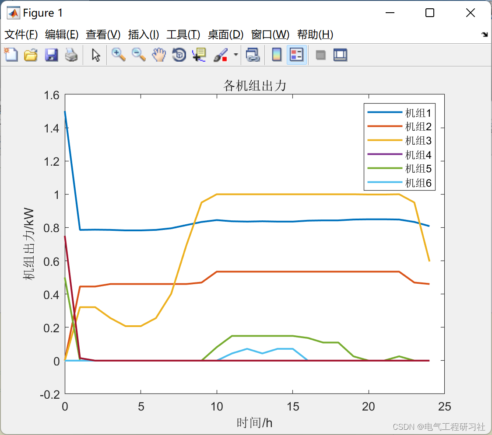
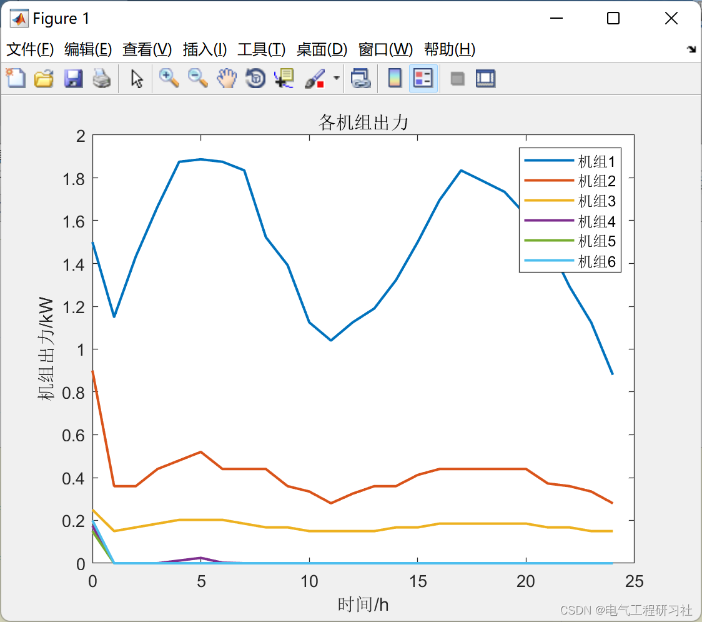
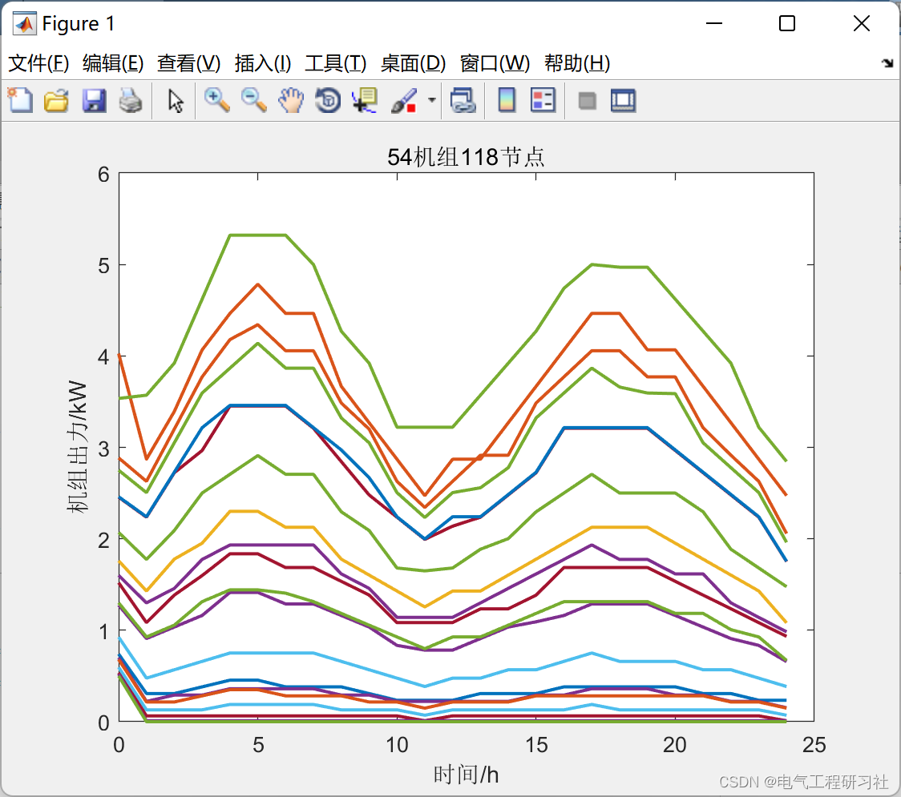
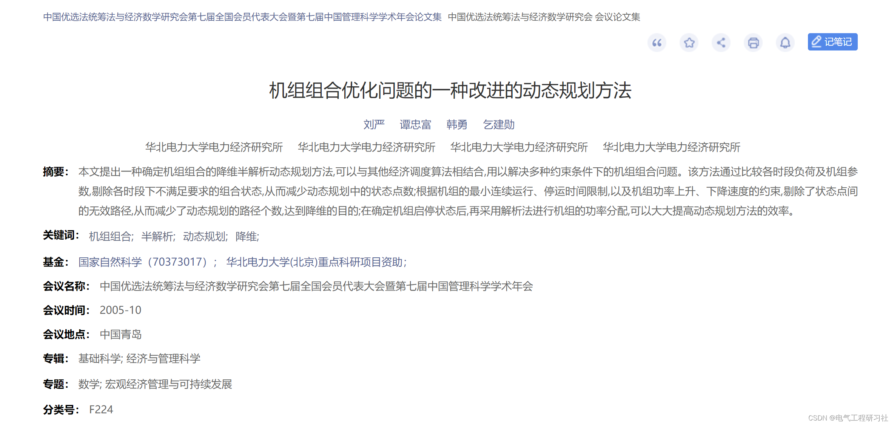
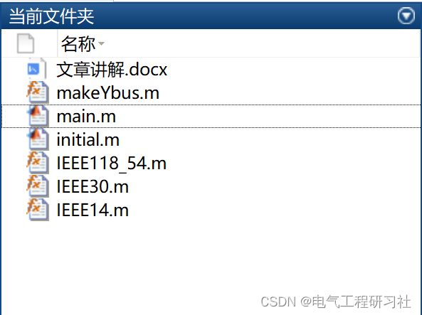

# Power System Unit Combination (IEEE14-node, IEEE30-node, IEEE118-node) (Matlab Code Implementation)

1. Overview of the paper proposes a dimensionality reduction semi-analytic dynamic programming method for determining unit combinations, which can be combined with other economic dispatch algorithms to solve unit combination problems under various constraints. This method eliminates unsatisfactory combination states by comparing load and unit parameters across different time periods, thereby reducing the number of state points in dynamic programming; based on the minimum continuous operation and shutdown time restrictions of units, as well as the constraints on the speed of power increase and decrease, it eliminates invalid paths between state points, thus reducing the number of dynamic programming paths and achieving dimensionality reduction. After determining the start-up and shutdown states of units, the power allocation is then performed using an analytical method, significantly enhancing the efficiency of the dynamic programming approach.
2. Key Points Learning on Unit Combination Problems: We have summarized these before, here are some learning links:
Power System Unit Combination (Matlab Code Realization)
Power System Unit Combination with Powerful Yalmip+Cplex
Improved Genetic Algorithm-Based Unit Combination Problem (Python Realization)
Power System Unit Combination with Powerful Yalmip+Cplex (Introduction + Matlab Realization of Unit Combination Problem)
3. Running Results:
3.1 Example 1 - IEEE14 Node Edit
3.2 Example 2 - IEEE30 Node Edit
3.3 Example 3 - IEEE118 Node Edit
4. Matlab Code and Article Reading:
This paper only showcases part of the code, all codes and detailed explanations can be found in:
​
% Curve of generator cost, quadratic function segment linearization\nP_nl = sdpvar(n_gen, n_L, n_T);\n% for i = 1: n_gen\nfor t = 1: n_T\n    C = [C,\n        gen_P(gen(:,GEN_BUS),t) == sum(P_nl(:,:,t), 2)+gen(:,GEN_PMIN).*u_state(gen(:,GEN_BUS),t)/baseMVA,\n        ];\n%         for l = 1: n_L\n    C = [C,\n        0 <= P_nl(:,:,t) <= (gen(:, GEN_PMAX)-gen(:, GEN_PMIN))/n_L/baseMVA*ones(1,n_L),\n        ];\n%         end\nend\n% end\n%%\n% Unit Startup Cost Cjk\ncost_up = sdpvar(n_gen, n_T);\nC = [C, cost_up >= 0];\nfor k = 1: n_T\n    for t = 1: k-1\n         C = [C,\n            cost_up(:,k) >= start_cost(:,t).*(u_state(gen(:,GEN_BUS),k) - sum(u_state(gen(:,GEN_BUS),[k-t: k-1]),2))\n            ];       \n    end\nend\nfor i = 1: n_gen\n    if (init_state(gen(i,GEN_BUS)) == 0)\n        C = [C,\n            cost_up(i,1) >= start_cost(i,init_down(i))*(u_state(gen(i,GEN_BUS),1)-init_down(i)*init_state(gen(i,GEN_BUS)))\n            ];\n    end\nend\n  
​  

## Images

<!-- PAYMENT_BLOCK -->

## Get this dataset

- Payment link (Stripe): [Buy now](https://buy.stripe.com/3cs8yP7sY87d0vu9AB)
- Payment QR code: 

<!-- /PAYMENT_BLOCK -->
